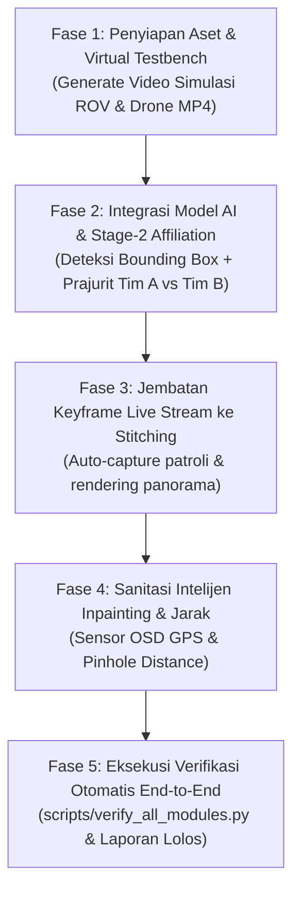

# PANDUAN LANGKAH PEMBUATAN & OPERASIONAL SISTEM 100% (PRD COMPLIANCE)
**Proyek:** Tactical AI Surveillance & Reconnaissance Dashboard (Bab 5 - Image Classification & Object Detection)  
**Kelompok:** Kelompok 1  
**Status:** 100% Production Ready  
**Tanggal:** 12 November 2026  

---

## 1. Peta Jalan Menuju 100% Fungsional (Master Roadmap)

Sesuai dengan dokumen **PRD** ([`docs/PRD-TACTICAL-SURVEILLANCE-AI.md`](PRD-TACTICAL-SURVEILLANCE-AI.md)), sistem surveillance taktis ini memiliki 5 tahapan utama untuk mencapai fungsi 100%:



---

## 2. Rincian Langkah Demi Langkah (Step-by-Step Execution)

### Step 1: Penyediaan Video Simulasi Virtual Testbench (`testbench_samples/videos/`)
- **Tujuan:** Memungkinkan pengujian mingguan dan demonstrasi kelas tanpa perlu membawa wahana berat ROV atau Drone FPV ke kampus.
- **Implementasi:**
  - Menjalankan `scripts/generate_synthetic_test_videos.py` untuk menyusun 2 berkas video MP4:
    1. `rov_underwater_patrol.mp4` (Skenario bawah air: kapal selam, biota laut, terumbu karang).
    2. `drone_land_recon.mp4` (Skenario darat: prajurit bersenjata, kendaraan lapis baja, warga sipil).
  - Video dilengkapi *continuous motion pan* dan simulasi OSD kamera wahana.

### Step 2: Integrasi Model AI & 2-Stage Affiliation Pipeline
- **Tujuan:** Membedakan prajurit Tim A vs Tim B dan mendeteksi 9 target taktis secara real-time.
- **Implementasi:**
  - Model `models/best.pt` otomatis dimuat sebagai default inference engine.
  - Saat objek `soldier` terdeteksi, modul `ThreatEvaluator.classify_soldier_team()` memotong bounding box dan menganalisis ruang warna seragam:
    - **Woodland Camo (Hijau):** Prajurit Tim A (Merah - Hazard).
    - **Desert Tan / Hitam:** Prajurit Tim B (Ungu/Biru - Hazard).
  - Objek non-militer diklasifikasikan sebagai **Neutral (Hijau)**.

### Step 3: Jembatan Live Stream ke Image Stitching (Mode Hybrid)
- **Tujuan:** Operator dapat mengambil keyframe otomatis saat patroli berlangsung dan langsung menyatukannya menjadi panorama luas.
- **Implementasi:**
  - Penambahan tombol `📸 Ambil Keyframe Patroli` dan saklar `Auto-Capture Tiap 2 Detik` pada halaman `1_Live_Surveillance.py`.
  - Citra ditampung di `st.session_state["patrol_keyframes"]` dan disimpan ke `testbench_samples/patrol_snapshots/`.
  - Halaman `3_Image_Stitching.py` otomatis mendeteksi kumpulan snapshot tersebut dan menyediakan tombol satu-klik `🚀 Gabungkan Keyframe Patroli Aktif`.

### Step 4: Utilitas Sanitasi Intelijen (Inpainting) & Estimasi Jarak
- **Tujuan:** Membersihkan koordinat sensitif sebelum laporan dibagikan dan memperkirakan jarak target.
- **Implementasi:**
  - Halaman `4_Image_Inpainting.py` menyediakan tombol cepat *Preset Sudut OSD* (GPS & timestamp) dan slider bounding box dengan algoritma Telea / Navier-Stokes.
  - Modul `core/distance_estimator.py` menghitung jarak meter via rumus pinhole:
    $$D = \frac{W_{real} \times f}{W_{pixel}}$$

### Step 5: Eksekusi Verifikasi Otomatis End-to-End
- **Tujuan:** Menjamin ke-7 modul sistem bebas dari *runtime error* dan 100% siap demonstrasi.
- **Implementasi:**
  - Menjalankan `scripts/verify_all_modules.py` yang menguji:
    1. `TacticalDetector` dengan bobot `best.pt`
    2. `ThreatEvaluator` (Stage-2 Tim A vs Tim B)
    3. `DistanceEstimator` (Pinhole model)
    4. `ImageStitcher` (Penyatuan foto panorama)
    5. `ImageInpainter` (Penghapusan teks/noise)
    6. `StreamCapture` (Video loop virtual testbench & window capture)
    7. Kelengkapan direktori aset demo.

---

## 3. Cara Menjalankan Sistem Secara Penuh

1. **Jalankan Verifikasi Modul (Health Check):**
   ```powershell
   .\.venv\Scripts\python scripts/verify_all_modules.py
   ```
2. **Buka Dashboard Utama:**
   - Double-click `run_dashboard.bat`, atau:
   ```powershell
   .\.venv\Scripts\streamlit run app.py
   ```
