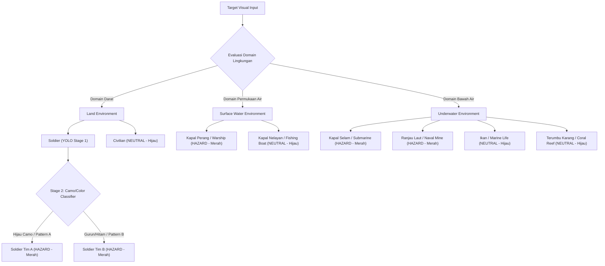

# PRODUCT REQUIREMENTS DOCUMENT (PRD)
## Tactical AI Surveillance & Reconnaissance Dashboard (Land, Surface Water & Underwater)
**Mata Kuliah:** Workshop Kecerdasan Buatan (Bab 5 - Image Classification & Object Detection)  
**Kelompok:** Kelompok 1  
**Versi Dokumen:** 1.0.0 (Final Approved Specification via `/grill-me`)  
**Status:** Approved for Implementation  
**Tanggal:** 10 November 2026  

---

## 1. Executive Summary & Problem Statement

### 1.1. Latar Belakang
Operasi pengintaian militer dan sipil modern di wilayah perbatasan melibatkan lingkungan multimodal yang mencakup darat, permukaan air, dan bawah air menggunakan wahana tanpa awak seperti *Remotely Operated Vehicle* (ROV) dan drone FPV. Operator menghadapi tantangan dalam:
- Mengidentifikasi objek secara cepat antara entitas berbahaya (*threat/hazard*) dan netral/sipil (*non-hazard*).
- Membedakan afiliasi personel darat (Tentara Tim A vs Tentara Tim B vs Warga Sipil).
- Melakukan sanitasi citra intelijen (menghapus koordinat OSD/noise) sebelum laporan patroli didistribusikan.
- Menggabungkan citra jalur patroli yang terfragmentasi menjadi satu panorama luas (*Image Stitching*).
- Memperkirakan jarak aman wahana ke objek ancaman (misal ranjau laut atau pangkalan musuh).

### 1.2. Tujuan Produk
Membangun dashboard surveillance taktis berbasis **Streamlit** dan **YOLO (Transfer Learning)** yang mampu menerima input live stream window aplikasi ROV/Drone, video MP4, dan foto statis, menyajikan klasifikasi ancaman real-time, estimasi jarak, utilitas computer vision (stitching & inpainting), serta menyediakan lingkungan pengujian mingguan (*virtual testbench*) tanpa ketergantungan pada alat fisik di kelas.

---

## 2. Taksonomi Kelas & Aturan Ancaman (*Threat Matrix*)

### 2.1. Tabel Taksonomi Terpadu

| ID | Nama Kelas | Domain Lingkungan | Status Ancaman (*Threat Status*) | Referensi Fisik ($W_{real}$) | Aksi Taktis Dashboard |
|:---:|---|:---:|:---:|:---:|:---:|
| `0` | `soldier_team_a` | Land | **HAZARD (Merah)** | $0.5\text{ m}$ | Bounding box Merah + Telemetri Jarak |
| `1` | `soldier_team_b` | Land | **HAZARD (Merah)** | $0.5\text{ m}$ | Bounding box Merah + Telemetri Jarak |
| `2` | `civilian` | Land | **NEUTRAL (Hijau)** | $0.5\text{ m}$ | Bounding box Hijau (Aman) |
| `3` | `warship` | Surface Water | **HAZARD (Merah)** | $25.0\text{ m}$ | Bounding box Merah + Alert Permukaan |
| `4` | `fishing_boat` | Surface Water | **NEUTRAL (Hijau)** | $6.0\text{ m}$ | Bounding box Hijau (Kapal Non-Militer) |
| `5` | `submarine` | Underwater | **HAZARD (Merah)** | $12.0\text{ m}$ | Bounding box Merah + Underwater Threat |
| `6` | `naval_mine` | Underwater | **HAZARD (Merah)** | $1.0\text{ m}$ | Bounding box Merah + Alert Kedekatan |
| `7` | `marine_life` | Underwater | **NEUTRAL (Hijau)** | $0.4\text{ m}$ | Bounding box Hijau (Biota Air) |
| `8` | `coral_reef` | Underwater | **NEUTRAL (Hijau)** | $1.5\text{ m}$ | Bounding box Hijau (Navigasi Aman) |

---

## 3. Spesifikasi Moda Masukan Data (*Input Modalities*)

### 3.1. Moda 1: Live Feed ROV / Drone (Screen Mirroring)
- **Mekanisme:** Menggunakan pustaka `pygetwindow` untuk mendeteksi seluruh window aplikasi aktif di sistem operasi Windows (misal: *QGroundControl, Mission Planner, VLC Player, OBS, Windows Camera*).
- **Proses Penangkapan:** Operator memilih window dari dropdown Streamlit. Pustaka `mss` menangkap bidang gambar window tersebut secara kontinu ($\ge 20\text{ FPS}$) tanpa overhead latensi tinggi.
- **Fallback:** Tersedia opsi memilih Direct USB Camera Index (`0`, `1`) atau RTSP Stream URL jika perangkat terhubung langsung via kabel LAN / USB capture card.

### 3.2. Moda 2: Upload Video MP4
- Menerima berkas video berformat `.mp4`, `.avi`, `.mov`.
- Fitur pemutaran video dengan slider kecepatan, tombol pause/resume, dan opsi *frame-skipping* (proses tiap $N$-frame) untuk menjaga kelancaran inferensi pada komputer tanpa GPU diskrit.

### 3.3. Moda 3: Upload Foto Tunggal (Single Image)
- Menerima berkas citra berformat `.jpg`, `.jpeg`, `.png`, `.webp`.
- Menghasilkan anotasi bounding box beresolusi penuh, tabel rincian probabilitas tiap objek, dan telemetri estimasi jarak.

### 3.4. Moda 4: Virtual Testbench (Simulasi Pengujian Mingguan)
- Mode khusus yang memutar video rekaman patroli secara *infinite loop* (auto-rewind ke detik ke-0 ketika video habis).
- Memungkinkan demonstrasi di kelas seolah-olah wahana ROV sedang menyelam atau drone sedang terbang secara live.

---

## 4. Pipeline Klasifikasi AI 2-Stage (Soldier Tim A vs Tim B)

Karena dataset publik Roboflow umumnya hanya memiliki label generik `soldier` atau `person`, sistem menggunakan pendekatan **2-Stage Pipeline**:
1. **Stage 1 (Object Localization):** YOLOv8/11 mendeteksi posisi bounding box prajurit (`soldier`) dan warga sipil (`civilian`).
2. **Stage 2 (Affiliation Classifier):**
   - Area bounding box prajurit dipotong (*crop*).
   - Analisis ruang warna (HSV/Color Histogram) atau CNN Feature Extractor memeriksa proporsi warna seragam:
     - **Tim A:** Didominasi corak *Green Woodland Camouflage* atau seragam hijau TNI.
     - **Tim B:** Didominasi corak *Desert Tan / Navy Camouflage / Hitam*.
   - Hasil klasifikasi Stage 2 otomatis mengubah ID label akhir menjadi `soldier_team_a` atau `soldier_team_b`.

---

## 5. Fitur Utilitas Computer Vision

### 5.1. Image Stitching (Jalur Patroli Panorama)
- **Alur Kerja:** Mode **Hybrid**:
  - *Metode A:* Pengguna mengunggah 2 hingga 10 foto jalur patroli beririsan secara manual.
  - *Metode B:* Operator menekan tombol *"Start Patrol Recording"*; sistem otomatis mengambil keyframe setiap 2 detik dari live stream, lalu menekan *"Finish & Stitch"* untuk merender panorama jalur lintasan wahana.
- **Algoritma:** OpenCV Stitcher (`cv2.Stitcher_create`) dengan pencocokan fitur SIFT/ORB, estimasi homografi RANSAC, dan *auto-trimming* batas hitam distorsi warping.

### 5.2. Image Inpainting (Sanitasi Noise & Koordinat OSD)
- **Alur Kerja:** Berbasis **Preset Bounding Box**:
  - Operator menentukan koordinat kotak $[X, Y, W, H]$ area yang ingin disensor melalui slider interaktif di antarmuka.
  - Tersedia tombol cepat **"Preset OSD Corners"** untuk langsung menyensor 4 sudut layar (tempat umum koordinat GPS, baterai, dan timestamp).
- **Algoritma:** Menggunakan algoritma *Fast Marching Method (Telea)* dan *Navier-Stokes* (`cv2.inpaint`) dengan radius rekonstruksi yang dapat diatur.

### 5.3. Estimasi Jarak Kamera (Pinhole Distance Estimation)
- Menghitung jarak relatif dari kamera wahana ke objek menggunakan model geometri pinhole:
  $$D = \frac{W_{real} \times f}{W_{pixel}}$$
- Nilai $W_{real}$ diambil otomatis dari tabel taksonomi sesuai kelas yang terdeteksi.
- Nilai focal length $f$ dapat dipilih via preset profil (Drone FPV, ROV Underwater Dome Port, Webcam) atau diatur presisi via slider.

---

## 6. Laporan & Output Misi (*Reporting & Telemetry Export*)

Setiap analisis pada dashboard dapat diekspor secara instan:
1. **Download Snapshot Citra:** Citra beranotasi bounding box taktis beresolusi asli (`.jpg`/`.png`).
2. **Download Citra Pasca-Inpaint:** Citra bersih setelah penghapusan koordinat sensitif.
3. **Download Panorama:** Hasil gabungan panorama patroli.
4. **Export Log Misi (CSV / Excel):** Berkas tabel riwayat rekaman yang mencakup:
   - `Timestamp`
   - `Class_Name` & `Display_Name`
   - `Threat_Status` (HAZARD / NEUTRAL)
   - `Confidence_Score` (%)
   - `Estimated_Distance` (meter)
   - `Environment_Domain` (Land / Surface / Underwater)

---

## 7. Rencana Pengetesan Mingguan (*Weekly Verification Protocol*)

| Milestone | Target Pengujian Mingguan | Indikator Keberhasilan (Acceptance Criteria) |
|---|---|---|
| **Minggu 1** | PRD & Architecture Finalization, Skema Folder, Setup Environment | PRD disetujui, struktur direktori terbentuk, dependensi terinstal. |
| **Minggu 2** | Integrasi & Remapping Dataset Roboflow, Pipeline 2-Stage | Script `remap_and_merge_datasets.py` berhasil menyatukan dataset; validasi label 9 kelas. |
| **Minggu 3** | Training YOLO Transfer Learning & Evaluasi Metrik | $mAP_{50} \ge 0.70$ pada dataset validasi; model bobot `best.pt` terbentuk. |
| **Minggu 4** | Uji Modul CV: Stitching, Inpainting, Estimasi Jarak | Stitching menghasilkan panorama mulus; inpainting menghapus sensor OSD tanpa artefak; rumus jarak terverifikasi. |
| **Minggu 5** | Integrasi Dashboard Streamlit & Live Demo Virtual Testbench | 4 moda input berjalan stabil, telemetry counter aktif, FPS $\ge 20$, siap dipresentasikan. |

