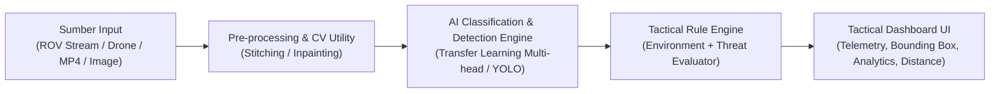

# SPEC-DRIVEN DEVELOPMENT (SDD) MASTER BLUEPRINT
**Proyek:** Workshop AI Kelompok 1 Bab 5 - Dashboard Klasifikasi Objek Militer & Sipil (Air & Darat)  
**Versi Dokumen:** 1.0.0-draft  
**Status:** In Review  

---

## 1. Ringkasan Eksekutif & Tujuan Sistem

Sistem ini adalah **Tactical AI Surveillance Dashboard** multimodal yang dirancang untuk menerima input visual dari berbagai sumber (live stream ROV/Drone, video recorder MP4, citra statis tunggal), mengklasifikasikan lingkungan operasi, mendeteksi dan mengidentifikasi objek militer vs sipil, mengevaluasi status ancaman secara real-time, serta menyediakan modul pendukung citra (*Image Stitching*, *Inpainting*, dan *Estimasi Jarak*).

---

## 2. Struktur Spesifikasi (Doc Suite Structure)

Untuk mengadopsi SDD secara rapi dan modular, dokumen spesifikasi dibagi menjadi 5 modul terpisah di folder `docs/specs/`:

| No | Dokumen Spesifikasi | Fokus Utama |
|---|---|---|
| **SPEC-01** | `01-system-requirements.md` | Functional & Non-Functional Requirements, User Stories, Input Modalities (Screen capture, RTSP/Webcam, File Uploads). |
| **SPEC-02** | `02-ai-taxonomy-and-datasets.md` | Taksonomi kelas (Air/Darat, Tim A/B, Militer/Non-militer), arsitektur model Transfer Learning, dataset format, metrik evaluasi. |
| **SPEC-03** | `03-cv-pipeline-algorithms.md` | Algoritma *Feature Matching & Stitching* (SIFT/ORB), *Inpainting* (Navier-Stokes/Telea), dan *Distance Estimation* (Pinhole Camera Model). |
| **SPEC-04** | `04-software-architecture-and-stack.md` | Pilihan Tech Stack (UI Framework, Backend processing, threading/multiprocessing untuk stream tanpa lag), antarmuka modular. |
| **SPEC-05** | `05-weekly-verification-and-testbench.md` | Protokol uji mingguan (*Mock feeds*, uji video offline sintetis, metrik confidence score, benchmarking FPS). |

---

## 3. Matriks Taksonomi Klasifikasi & Deteksi (Draft SPEC-02)

### A. Hierarki Klasifikasi
1. **Level 1 - Domain Lingkungan (*Environment*):**
   - `Land` (Darat)
   - `Surface Water` (Permukaan Air)
   - `Underwater` (Bawah Air)

2. **Level 2 - Status Ancaman (*Threat Level*):**
   - **Hazard / Threat (Berbahaya):** Kapal Perang, Kapal Selam, Ranjau Laut, Tentara (Soldier Tim A / Tim B).
   - **Non-Hazard / Neutral (Tidak Berbahaya):** Kapal Nelayan, Biota Air / Ikan, Terumbu Karang, Warga Sipil (Civilian).

3. **Level 3 - Objek Spesifik (*Target Classes*):**
   - **Darat:** `Soldier Tim A`, `Soldier Tim B`, `Civilian`.
   - **Air (Permukaan & Bawah Air):** `Warship`, `Fishing Boat`, `Submarine`, `Naval Mine`, `Fish/Marine Life`, `Coral Reef`.

---

## 4. Spesifikasi Fitur Khusus Computer Vision (Draft SPEC-03)

### 4.1. Modul Input Feeds
- **Window/Screen Mirroring Capture:** Mengambil visual window/layar software pengendali ROV/FPV drone (misal: QGroundControl, Mission Planner, OBS, atau window webcam) via DirectShow / MSS library (60+ FPS low latency).
- **Video & Image Upload:** Support container `.mp4`, `.avi`, `.jpg`, `.png`, `.webp`.

### 4.2. Image Stitching (Panorama Jalur Patroli)
- **Metode:** Feature extraction (ORB/SIFT/AKAZE) $\to$ RANSAC Homography $\to$ Image Warping & Blending.
- **Trigger:** Otomatis dari frame beruntun (overlap $>30\%$) atau manual multi-image select.

### 4.3. Image Inpainting (Sanitasi Citra & Sensor Data)
- **Metode:** Masking area sensitif (koordinat GPS, timestamp, noise artefak) menggunakan Telea / Navier-Stokes (`cv2.inpaint`) atau model Fast Inpainting.
- **Mode:** Interactive Bounding Box / Brush Masker pada dashboard sebelum export laporan.

### 4.4. Estimasi Jarak Kamera ke Objek (Opsional)
- **Metode:** *Pinhole Camera Geometry Model*:
  $$D = \frac{W_{real} \times f}{W_{pixel}}$$
  - $W_{real}$: Estimasi dimensi fisik objek referensi (misal: lebar rata-rata manusia = $0.5\text{ m}$, panjang kapal).
  - $f$: Focal length hasil kalibrasi kamera dasar.
  - $W_{pixel}$: Lebar bounding box dalam piksel.

---

## 5. Rencana Pengujian Mingguan Tanpa Hardware Berat (Draft SPEC-05)

Sesuai catatan pengetesan:
1. **Virtual Hardware Testbench:**
   - Menyediakan generator feed virtual yang memutar *looping recorded video* (ROV/Drone footage) seolah-olah berasal dari camera stream live.
2. **Confidence Benchmarking Suite:**
   - Script benchmark otomatis untuk menguji inferensi model pada dataset validasi (mencatat akurasi, mAP, presisi, recall, dan FPS).
3. **Weekly Progress Checklist:**
   - Minggu 1: Finalisasi Spec & Persiapan Dataset / Mock Feeds.
   - Minggu 2: Training Model Transfer Learning & Uji Klasifikasi Dasar.
   - Minggu 3: Implementasi Stitching, Inpainting, & Estimasi Jarak.
   - Minggu 4: Integrasi Dashboard UI & Skenario Simulasi Live Test.

