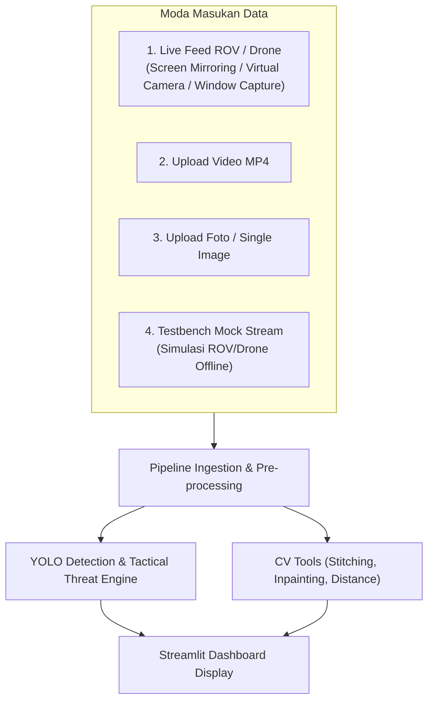

# SPEC-01: SYSTEM REQUIREMENTS SPECIFICATION (SRS)
**Proyek:** Tactical Surveillance Dashboard AI (Air & Darat)  
**Target Platform:** Windows 10/11, Python 3.10/3.11, Streamlit  

---

## 1. Lingkup & Modus Input (Input Modalities)

Dashboard wajib mendukung 4 moda input sesuai *User Flow*:

### 1.1. Spesifikasi Teknis Tiap Input
1. **Screen / Window Mirroring (Live Feed ROV / Drone):**
   - Menggunakan library `mss` atau `pygetwindow` + OpenCV untuk menangkap area window aplikasi ROV (misal: QGroundControl) atau FPV stream desktop secara real-time.
   - Fallback ke webcam direct index (`cv2.VideoCapture(0/1)`) atau RTSP stream URL jika drone/ROV memiliki RTSP server.
2. **Upload Video MP4:**
   - Menerima file `.mp4`, `.avi`, `.mov`.
   - Pemrosesan frame-by-frame dengan slider kontrol progress dan opsi *skip frame* untuk menjaga performa.
3. **Upload Foto Tunggal:**
   - Menerima `.jpg`, `.jpeg`, `.png`, `.webp`.
   - Menampilkan hasil deteksi, bounding box, dan tabel ringkasan confidence score.
4. **Offline Testbench (Pengetesan Mingguan):**
   - Mode simulasi khusus yang membaca video sampel berulang (*loop*) seolah-olah kamera ROV/drone sedang aktif di air/udara.

---

## 2. Kebutuhan Fungsional (Functional Requirements)

| ID | Modul | Deskripsi Kebutuhan |
|---|---|---|
| **FR-01** | Feed Selector | Pengguna dapat memilih sumber input melalui sidebar Streamlit secara dinamis tanpa restart aplikasi. |
| **FR-02** | Real-time Inference | Model YOLO mendeteksi objek secara per-frame dengan latency target $\le 50\text{ ms}$ (pada GPU) atau $\le 150\text{ ms}$ (pada CPU). |
| **FR-03** | Threat Evaluation | Sistem otomatis memetakan objek terdeteksi ke status: **Berbahaya (Merah)** vs **Tidak Berbahaya / Netral (Hijau)**. |
| **FR-04** | Environment Classifier | Sistem menentukan kategori domain lingkungan (Land, Surface Water, Underwater) berdasarkan proporsi objek atau heuristik background. |
| **FR-05** | Image Stitching | Pengguna dapat mengunggah 2 atau lebih citra jalur patroli dan menghasilkan panorama gabungan beresolusi penuh. |
| **FR-06** | Image Inpainting | Pengguna dapat menandai area sensitif (koordinat, noise, timestamp) dan menghilangkannya menggunakan algoritma inpainting. |
| **FR-07** | Estimasi Jarak | Sistem menghitung perkiraan jarak target (meter) dari kamera menggunakan model pinhole geometris. |
| **FR-08** | Laporan & Export | Pengguna dapat mengunduh (*download*) hasil tangkapan frame, laporan log ancaman (CSV/JSON), dan citra pasca-inpaint. |

