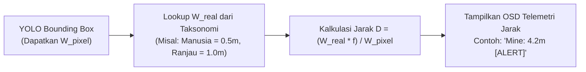

# SPEC-03: COMPUTER VISION UTILITY SPECIFICATION
**Proyek:** Tactical Surveillance Dashboard AI (Air & Darat)  
**Komponen:** Image Stitching, Image Inpainting, Distance Estimation  

---

## 1. Modul 1: Image Stitching (Panorama Jalur Patroli ROV / Drone)

### 1.1. Kasus Penggunaan
Kamera ROV bawah air atau drone udara bergerak di sepanjang jalur koordinat/patroli. Objek luas (misal formasi terumbu karang, instalasi pipa bawah air, pangkalan militer darat) tidak muat dalam 1 bidang pandang (*Field of View*). Pengguna mengunggah rentetan foto yang bertampalan (*overlapping*) untuk digabungkan menjadi 1 citra panorama.

### 1.2. Algoritma & Pipeline Teknis
1. **Feature Detection & Description:** Menggunakan `cv2.SIFT_create()` atau `cv2.ORB_create()` untuk mendeteksi keypoints dan deskriptor invarian rotasi/skala.
2. **Feature Matching:** `cv2.FlannBasedMatcher` atau `cv2.BFMatcher` dengan Lowe's Ratio Test ($< 0.75$).
3. **Homography Estimation:** Estimasi matriks transformasi $H$ via RANSAC (`cv2.findHomography(src, dst, cv2.RANSAC, 4.0)`).
4. **Warping & Seamless Blending:** Warp perspective dan multi-band/feather blending untuk meminimalisir garis batas (*seamline*).
5. **OpenCV Fallback:** Menggunakan engine level tinggi `cv2.Stitcher_create(cv2.Stitcher_PANORAMA)` yang sangat stabil untuk foto beruntun.

---

## 2. Modul 2: Image Inpainting (Sanitasi Noise & Sensor Koordinat)

### 2.1. Kasus Penggunaan
Sebelum laporan intelijen/patroli diekspor atau dibagikan:
- Koordinat sensitif GPS / OSD (On-Screen Display) drone perlu disensor agar tidak bocor.
- Artefak optik (pantulan gelembung udara ROV, goresan lensa kubah / *dome port*, debu drone) perlu dibersihkan secara mulus tanpa meninggalkan lubang hitam/putih.

### 2.2. Algoritma Teknis
1. **Interactive Masking:** Pengguna memilih area masker pada dashboard Streamlit via kanvas gambar (`streamlit-drawable-canvas`) atau seleksi bounding box koordinat.
2. **Inpainting Reconstruction:**
   - **Metode Telea (Fast Marching Method):** `cv2.inpaint(img, mask, inpaintRadius=3, flags=cv2.INPAINT_TELEA)` — mempertahankan gradien halus.
   - **Metode Navier-Stokes (Fluid Dynamics PDE):** `cv2.inpaint(..., flags=cv2.INPAINT_NS)` — ideal untuk tekstur air berkelanjutan atau permukaan seragam.

---

## 3. Modul 3: Estimasi Jarak Objek ke Kamera (Distance Estimation)

### 3.1. Kasus Penggunaan
Operator ROV/Drone perlu mengetahui perkiraan jarak target (misal: jarak aman ranjau laut ke lambung ROV, atau jarak drone ke tentara di darat).

### 3.2. Formulasi Matematika (Pinhole Geometric Model)

Hubungan segitiga sebangun antara bidang sensor kamera dan dunia nyata dinyatakan dengan:

$$f = \frac{W_{pixel\_ref} \times D_{ref}}{W_{real}}$$

Di mana:
- $W_{real}$ = Dimensi fisik aktual objek (meter).
- $W_{pixel}$ = Lebar bounding box objek dalam piksel (diperoleh langsung dari bounding box YOLO: `x2 - x1`).
- $f$ = *Focal length* kamera terkalibrasi (dalam satuan piksel).
- $D$ = Jarak dari kamera ke objek (meter).

Maka saat operasi real-time:
$$D = \frac{W_{real} \times f}{W_{pixel}}$$

### 3.3. Nilai Default Kalibrasi Kamera
Jika pengguna belum melakukan kalibrasi papan catur (*chessboard calibration*), sistem menyediakan nilai default profil kamera umum:
- **Drone FPV / Action Cam (Wide FOV ~90° - 120°):** $f \approx 600 - 800\text{ px}$ pada resolusi $1280 \times 720$.
- **ROV Underwater Cam (Flat Port):** $f \approx 750 - 950\text{ px}$.
- Slider interaktif di sidebar Streamlit untuk fine-tuning focal length secara langsung di lapangan.

