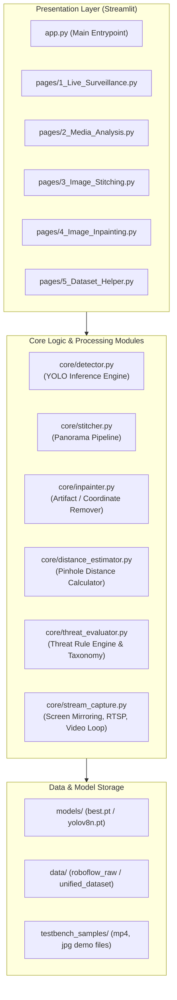

# SPEC-04: SOFTWARE ARCHITECTURE & PROJECT STRUCTURE
**Proyek:** Tactical Surveillance Dashboard AI (Air & Darat)  
**Framework:** Python 3.10+, Streamlit, OpenCV, Ultralytics YOLO  

---

## 1. Arsitektur Komponen Sistem



---

## 2. Struktur Direktori Proyek

```text
Projek/
├── docs/
│   └── specs/                     # Seluruh dokumen Spec-Driven Development
│       ├── 00-master-specification.md
│       ├── 01-system-requirements.md
│       ├── 02-ai-and-dataset-spec.md
│       ├── 03-cv-pipeline-spec.md
│       ├── 04-software-architecture.md
│       └── 05-weekly-verification-and-testbench.md
│
├── core/                          # Logika Inti & Algoritma (Headless / Decoupled dari UI)
│   ├── __init__.py
│   ├── detector.py                # Wrapper inferensi YOLO + Bounding Box visualizer
│   ├── threat_evaluator.py        # Logika klasifikasi ancaman (Merah/Hijau) & lingkungan
│   ├── distance_estimator.py      # Rumus estimasi jarak piksel -> meter
│   ├── stitcher.py                # Algoritma SIFT/Homography Image Stitching
│   ├── inpainter.py               # Algoritma Telea / Navier-Stokes Inpainting
│   └── stream_capture.py          # Window capture (MSS) & Virtual video loop
│
├── pages/                         # Multi-page Streamlit Dashboard
│   ├── 1_Live_Surveillance.py     # Live ROV / Drone stream & Screen Mirroring
│   ├── 2_Media_Analysis.py        # Upload Video MP4 & Single Image
│   ├── 3_Image_Stitching.py       # Penggabungan foto jalur patroli
│   ├── 4_Image_Inpainting.py      # Sanitasi sensor koordinat & noise
│   └── 5_Dataset_Helper.py        # Tool visual untuk cek label & merge dataset Roboflow
│
├── scripts/                       # Skrip CLI untuk Training & Persiapan Data
│   ├── remap_and_merge_datasets.py# Skrip otomatisasi penggabungan dataset Roboflow
│   ├── train_yolo.py              # Script training transfer learning YOLOv8/11
│   └── benchmark_model.py         # Skrip uji performa & metrik mingguan
│
├── models/                        # Tempat file model .pt (pre-trained & fine-tuned)
│   └── .gitkeep
│
├── testbench_samples/             # Sampel video/foto offline untuk demo & uji mingguan
│   ├── videos/
│   └── images/
│
├── app.py                         # Halaman Beranda & Overview Dashboard
├── requirements.txt               # Daftar pustaka dependensi Python
└── README.md                      # Panduan instalasi dan penggunaan
```

---

## 3. Prinsip Desain: *Decoupled Core*
Setiap fungsi di dalam folder `core/` dibuat berupa fungsi/kelas Python murni tanpa ketergantungan langsung pada Streamlit. Hal ini memungkinkan:
1. Pengujian otomatis (*unit testing*) tanpa harus membuka browser.
2. Skrip training/evaluasi mingguan berjalan secara independen.
3. Kode mudah dipindahkan ke framework lain (misal jika di masa depan ingin dikonversi ke desktop app atau API server).

