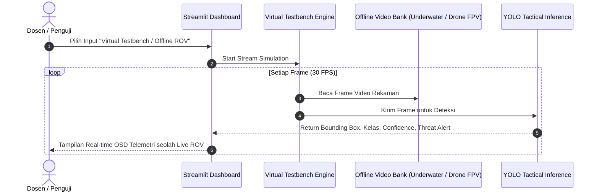

# SPEC-05: WEEKLY VERIFICATION & VIRTUAL TESTBENCH PLAN
**Proyek:** Tactical Surveillance Dashboard AI (Air & Darat)  
**Tujuan:** Protokol validasi mingguan tanpa memerlukan kehadiran fisik ROV/Drone di lab/kelas  

---

## 1. Konsep Virtual Hardware Testbench

Untuk menyiasati kendala membawa perangkat fisik (ROV seberat belasan kg, kolam uji air, dan drone FPV outdoor), sistem dilengkapi modul **Virtual Feed Generator**:

---

## 2. Kategori Rekaman Uji (*Video Test Bank*)

Sistem akan disiapkan dengan folder `testbench_samples/videos/` berisi 4 skenario uji:
1. **`scenario_underwater_mine.mp4`**: Rekaman bawah air dengan objek ranjau laut / kapal selam untuk menguji status **Threat (Berbahaya)**.
2. **`scenario_underwater_reef_fish.mp4`**: Rekaman bawah air terumbu karang dan ikan untuk menguji status **Neutral (Aman)**.
3. **`scenario_surface_warship.mp4`**: Rekaman permukaan air dengan kapal perang vs kapal nelayan.
4. **`scenario_drone_infantry.mp4`**: Rekaman kamera drone udara memantau pergerakan tentara (Tim A vs Tim B vs Civilian).

---

## 3. Matriks Evaluasi & Checklist Uji Mingguan (*Weekly Milestone Checklist*)

| Minggu | Target Uji (*Milestone*) | Metode Pembuktian (*Verification Artifact*) | Kriteria Lolos (*Acceptance Criteria*) |
|:---:|---|---|---|
| **M1** | Finalisasi Spesifikasi & Setup Repository | Seluruh dokumen SPEC di `docs/specs/` tervalidasi dan skema folder terbentuk. | Review kelompok & dosen disetujui. |
| **M2** | Ingest & Merge Dataset Roboflow | Menjalankan `scripts/remap_and_merge_datasets.py` pada dataset yang sudah diunduh. | Dataset terpadu terbentuk dengan pembagian `train/val/test` yang valid dan terbaca oleh YOLO. |
| **M3** | Training & Evaluasi Model AI (Transfer Learning) | Menjalankan training YOLOv8/11 dan menghasilkan kurva evaluasi (`confusion_matrix.png`, `results.png`). | $mAP_{50} \ge 0.70$ untuk kelas target militer dan non-militer. |
| **M4** | Modul CV: Stitching & Inpainting & Distance | Pengujian fungsi `stitcher.py`, `inpainter.py`, dan `distance_estimator.py` dengan citra uji. | Panorama berhasil digabung tanpa distorsi parah; area sensor berhasil di-inpaint mulus; jarak terhitung dalam meter. |
| **M5** | Integrasi Penuh Dashboard Streamlit | Demo live via Virtual Testbench dan Window Screen Capture. | Seluruh 4 moda input berfungsi mulus, latency streaming $\le 100\text{ ms}$, status ancaman akurat. |

